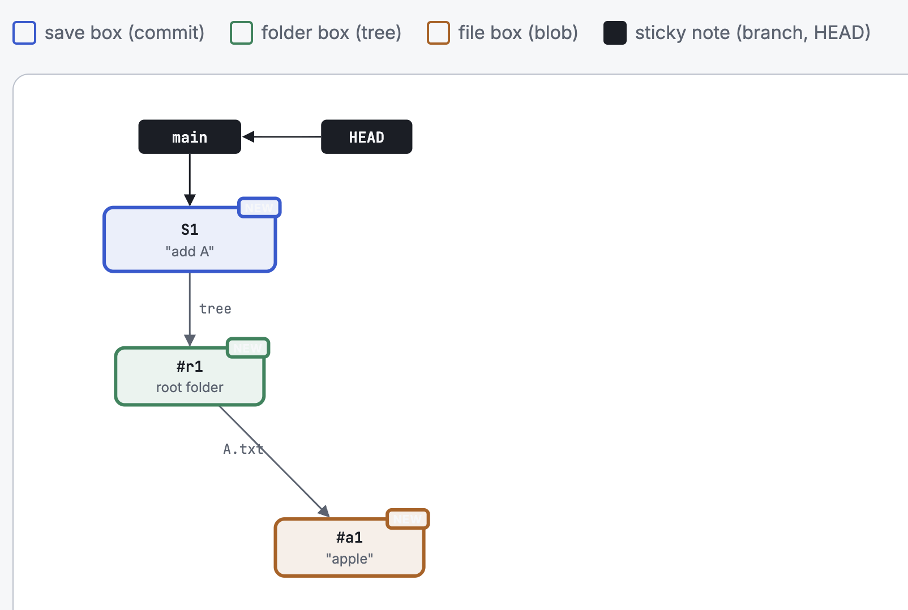
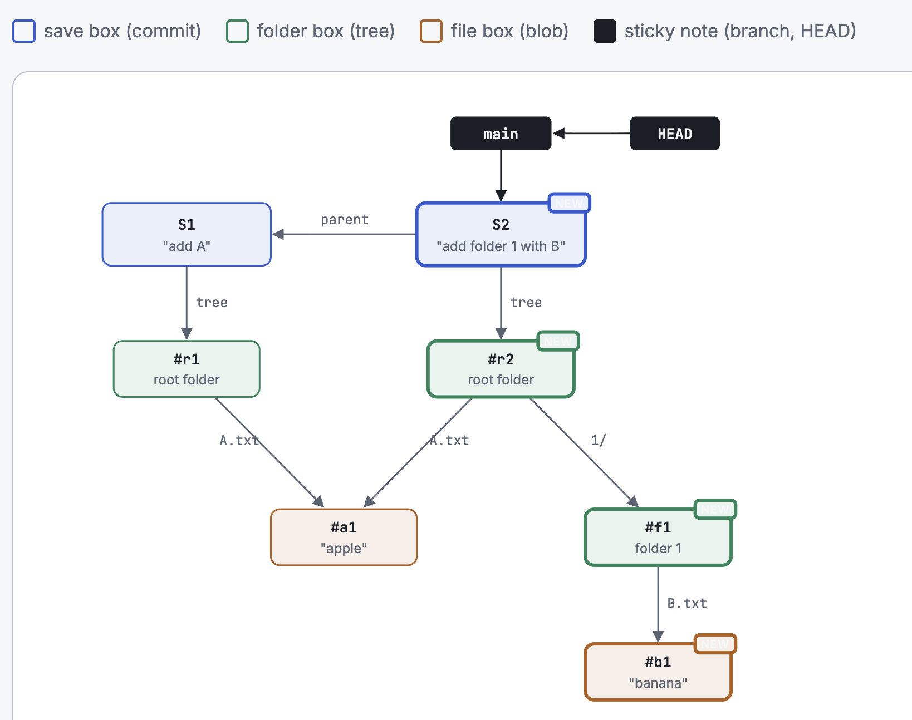
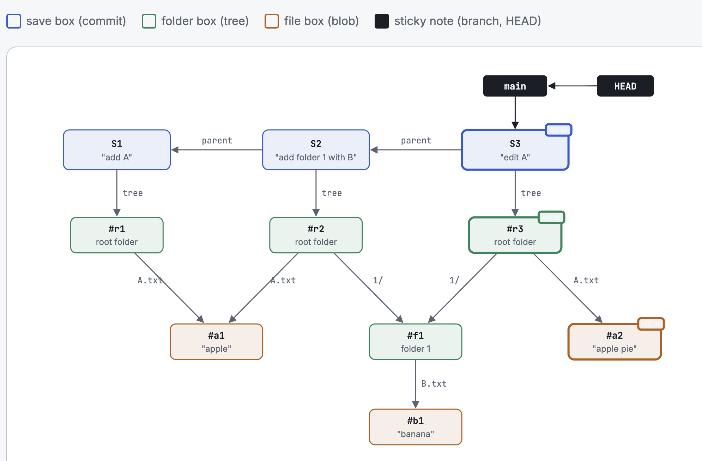

# 00 · Example walkthrough: the boxes, step by step

A concrete example of what Git stores when we add and commit files. For the
general rules behind it, see [00-background](00-background.md).

**Interactive version:** [example-walkthrough.html](https://johannesemme.github.io/tiny-tech/projects/tiny-git/notes/example-walkthrough.html)
(click through the steps and see what's inside each box).

Fingerprints here are made up and shortened (`#a1`, `S1`); real ones are 40
characters. Sizes like `33` and `170` are illustrations too.

Types in folder boxes:

- `040000` = folder
- `100644` = normal file

## 1) Create A.txt with "apple" in it

`git add A.txt`:

```
#a1:  blob 6\0apple\n
```

`git commit -m "add A"`:

```
#r1:  tree 33\0
      100644 A.txt #a1

S1:   commit 170\0
      tree #r1
      author Me <me@example.com> 1767268800 +0100
      committer Me <me@example.com> 1767268800 +0100

      add A
```



Storage: `#a1 #r1 S1`, which is 3 boxes.

## 2) Add B.txt under the folder 1 with "banana" in it

So `1/B.txt` is added.

`git add 1/B.txt`:

```
#b1:  blob 7\0banana\n
```

`git commit -m "add folder 1 with B"`:

```
#f1:  tree <size>\0
      100644 B.txt #b1

#r2:  tree <size>\0
      040000 1     #f1
      100644 A.txt #a1

S2:   commit <size>\0
      tree #r2
      parent S1
      author Me <me@example.com> 1767355200 +0100
      committer Me <me@example.com> 1767355200 +0100

      add folder 1 with B
```



Storage: `#a1 #r1 S1 #b1 #f1 #r2 S2`, which is 7 boxes.

## 3) Edit A.txt

First change the content of A.txt to "apple pie":

```sh
echo "apple pie" > A.txt
```

`git add A.txt`:

```
#a2:  blob 10\0apple pie\n
```

The content is different, so the fingerprint is different, so it's a new box.

Index:

```
A.txt   → #a2   ← changed
1/B.txt → #b1   ← unchanged
```

`git commit -m "edit A"`:

```
#r3:  tree <size>\0
      040000 1     #f1      ← same as in #r2
      100644 A.txt #a2      ← was #a1 in #r2

S3:   commit <size>\0
      tree #r3
      parent S2
      author Me <me@example.com> 1767441600 +0100
      committer Me <me@example.com> 1767441600 +0100

      edit A
```

Then `main` is moved to S3.



Storage: `#a1 #r1 S1 #b1 #f1 #r2 S2 #a2 #r3 S3`, which is 10 boxes.

## Summary

| Step | New boxes | Reused |
| ---- | --------- | ------ |
| 1. add A | `#a1`, `#r1`, `S1` | nothing |
| 2. folder 1 + B | `#b1`, `#f1`, `#r2`, `S2` | `#a1` (A didn't change) |
| 3. edit A | `#a2`, `#r3`, `S3` | `#f1` (the whole folder 1) |

The old `#a1` ("apple") is still in storage after step 3, because S1 and S2
point to it.
